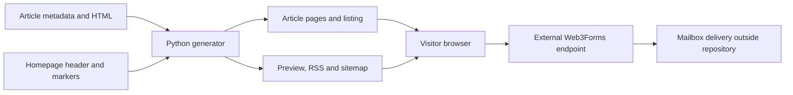

# Architecture map

The implementation has two independent paths: **build public articles locally** and **submit an inquiry from a visitor's browser**. Static hosting serves their files; it is not the form's backend.

In words: the generator reads article pairs and parts of the homepage, then writes public files. The browser reads the static site and may send an inquiry to an external provider. The provider's mail relay and mailbox are outside local code and test observation.

## Component responsibilities

| Component | Owns | Does not own |
| --- | --- | --- |
| `index.html`, `thank-you.html`, `styles.css`, `shield-mark.svg` | Public copy, layout, field attributes, contact alternatives and outcomes | Provider routing confirmation or customer records |
| `inquiry.js` | Validation UI, duplicate guard, JSON request, acceptance/error state | Server validation, spam resistance or inbox receipt |
| `content/blog/` | Five public metadata/body pairs | Generated pages or device implementation |
| `build-blog.py` | Article/listing templates, structured data, TOC, preview, feed, sitemap | Scheduler, stale-path deletion, atomic multi-file build |
| `tests/` | Local structure/markup and synthetic JS checks; separate owner activation utility | Browser rendering, provider/mailbox or deployment acceptance |
| `_config.yml`, `CNAME`, `robots.txt` | Declared publish exclusions, custom domain, crawler discovery | Actual remote Pages/DNS state |
| Private docs and external hook adapter | Maintainer explanations and shared documentation enforcement route | A second live business status authority |

## Follow a lifecycle

- [Generation and publication dataflow](architecture/publication-dataflow.md): validation order, trusted HTML and output failure modes.
- [Inquiry lifecycle](architecture/inquiry-lifecycle.md): active/dormant, native/enhanced, provider/inbox states.
- [Developer source map](development/source-map-and-requirements.md): modules, native runtimes and real extension points.

The decorative `$ aegis solve`/`$ aegis notes` strings and homepage sample `build-spec.json` are presentation, not repository CLIs or schemas. No local backend, database, payment handler, device runtime or camera dashboard implementation is present.
