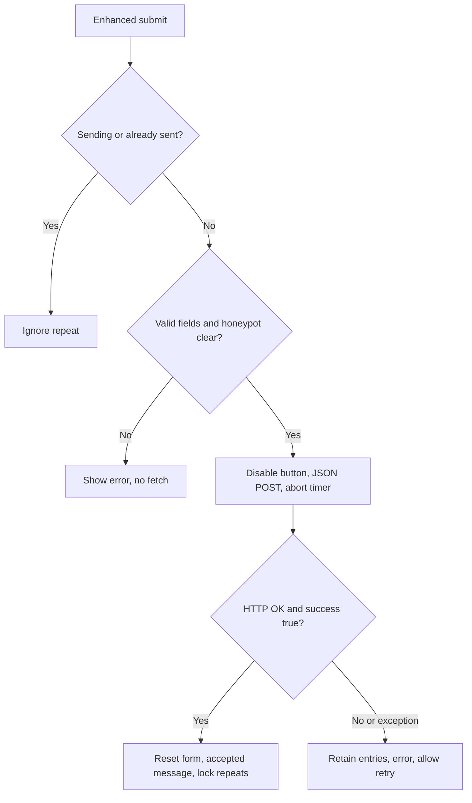

# Inquiry lifecycle

The shipped form is in active Web3Forms mode. Dormant `mailto:` behavior remains in tests and the initial activation helper as a historical transition, not the current deployed-mode claim. [Fields/provider reference](../reference/inquiry-fields-and-provider.md) defines the payload.

## Native and enhanced paths

With no enhancement, the active HTML form posts to the external HTTPS endpoint. It has no custom `enctype`, so the browser uses its normal form POST encoding. The enabled hidden redirect points to the thank-you page. Browser constraints still apply; JavaScript duplicate/error UI does not.

The JavaScript installs handlers only if the form exists, its action equals the expected endpoint, and an enabled nonempty non-placeholder routing field exists (`inquiry.js:1-8`). Otherwise it leaves native behavior alone. This guard does not verify a UUID or provider ownership; the offline Python markup check validates the expected UUID-shaped active value.

In words: the controller guards repeats, validates fields and the bot box, then makes one request. Only an HTTP-success response with literal JSON success true clears entries and locks further enhanced submits. Other outcomes retain entries and reopen the button.

## Request and visible states

`FormData` is converted into a plain object, the native-only redirect is deleted, and JSON is posted with JSON request/accept headers. An AbortController timer aborts after 20,000 ms. No automatic retry exists (`inquiry.js:45-55`).

- Invalid fields call `reportValidity` and show a required-field error.
- Checked honeypot shows an error without making a request.
- Sending sets disabled button, `aria-busy` and status text.
- After response JSON parses successfully, HTTP 429 asks the reader to retry later or email.
- Other HTTP failures or false success with parsed JSON retain entries and show a retry/email error.
- JSON parsing, network or abort exceptions say delivery could not be confirmed; check before retrying. A non-JSON 429 takes this exception path, not the rate-limit-specific path.
- Accepted response sets `sent`, resets fields, focuses status and leaves the button disabled for this page lifetime.

State is in-memory only. There is no local persistence, mailbox query or resend queue. A new page load is not covered by the in-page repeat guard.

## Acceptance is not receipt

The provider controls server-side validation, anti-spam and relay. The mailbox is a separate stage. The thank-you page explicitly says opening it directly sends/confirms nothing (`thank-you.html:30-31`). Enhanced success carefully says accepted for delivery, not received by Aegis.

A current receipt claim needs one clearly labeled, approved browser submission and inbox confirmation. Offline checks and the historical host-side HTTP403 cannot replace that evidence. [Diagnosis](../how-to/diagnose-inquiry.md) explains safe interpretation without duplicate sends.
